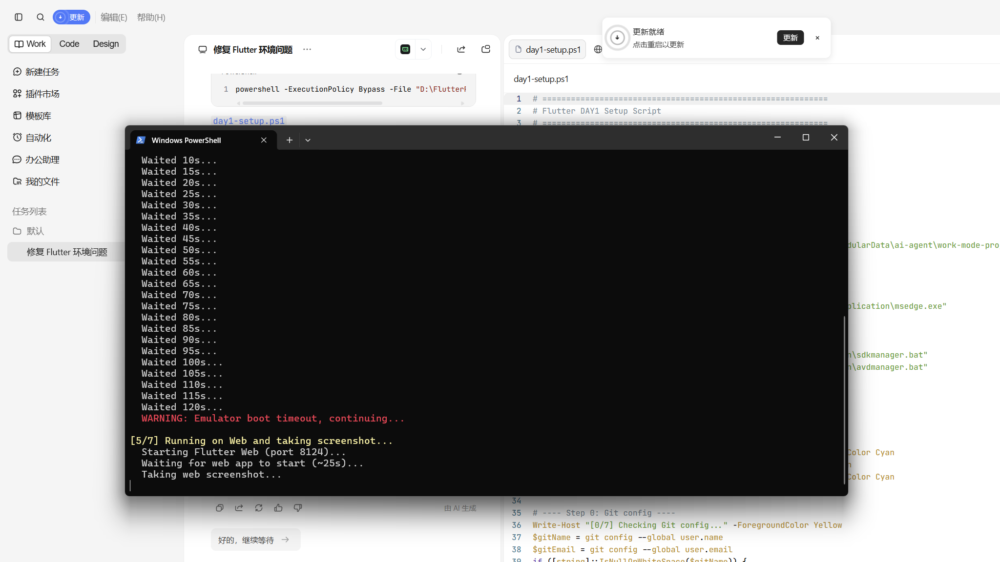
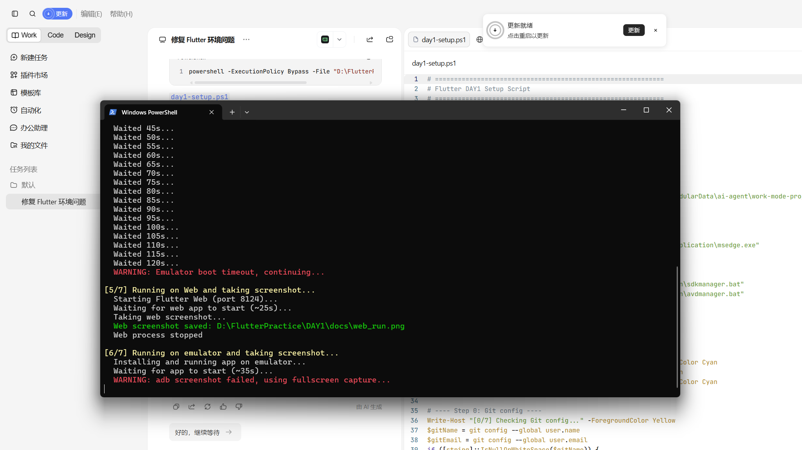

# Flutter DAY1 - Hello World

第一个 Flutter 应用：在 Web 端与 Android 模拟器运行的计数器示例。

## 项目结构

- `lib/main.dart` - 应用入口（runApp 挂载根组件 MyApp）
- `pubspec.yaml` - 依赖与资源声明
- `android/` - Android 平台工程
- `web/` - Web 平台工程
- `windows/` - Windows 平台工程
- `docs/` - 运行截图

## 运行方式

### Web 端

```bash
cd hello_world
flutter run -d chrome
```

### Android 模拟器

```bash
# 查看可用模拟器
flutter emulators
# 启动模拟器
flutter emulators --launch [模拟器名称]
# 运行应用
flutter run -d [模拟器ID]
```

### Windows 桌面

```bash
flutter run -d windows
```

## 运行截图

### Web 端



### Android 模拟器



## Git 提交记录

1. `feat: flutter create hello_world` - 创建 Flutter 项目骨架
2. `feat: run on web and emulator with screenshots` - 多端运行并保存截图
3. `docs: add README with screenshots` - 添加 README 文档与截图说明
