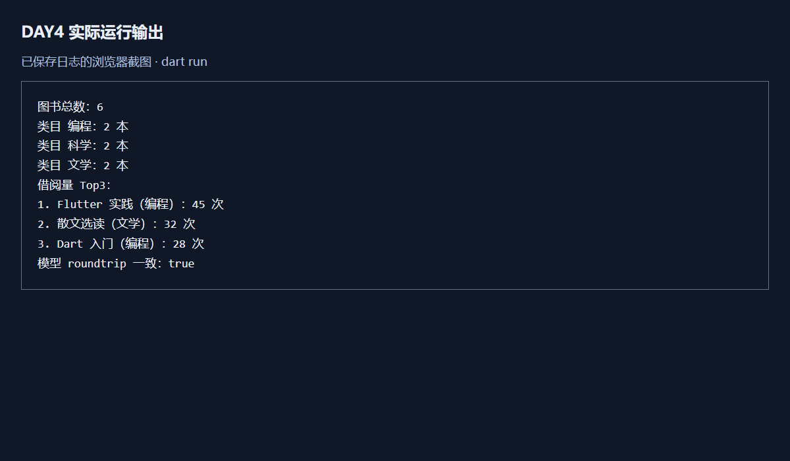
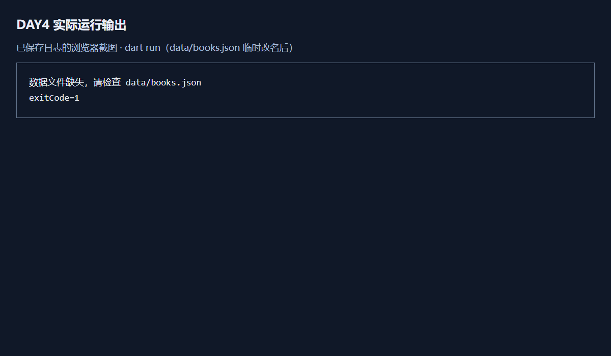
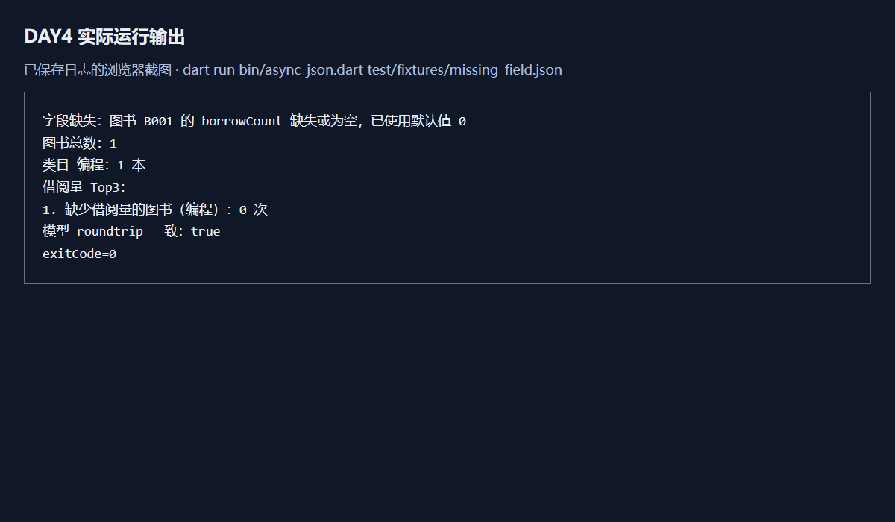
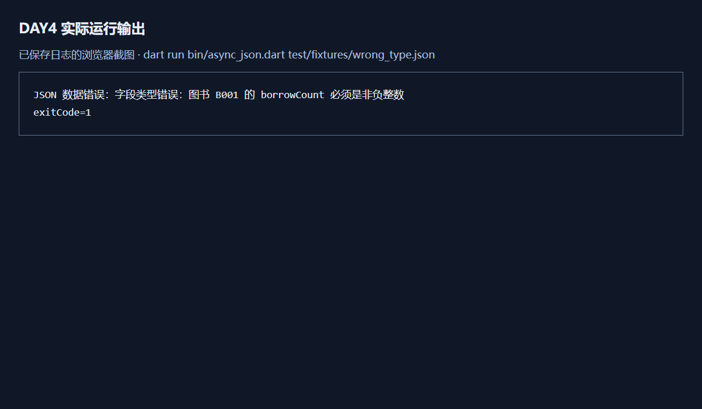
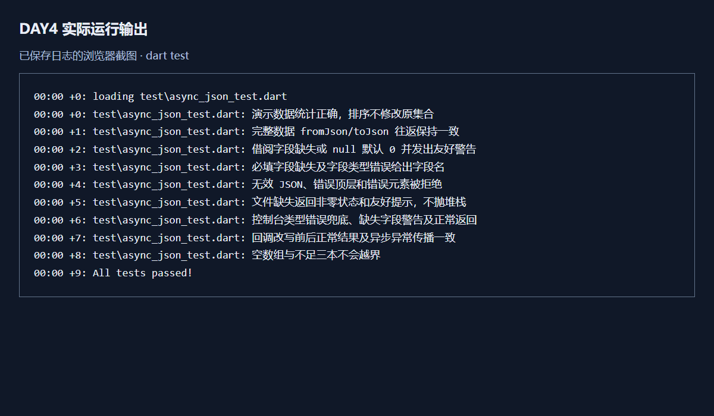

# 进度报告4

第6周 Dart语言基础三 异步 异常与包管理

## 一、任务理解

实现 async_json：异步读取本地 JSON 为 Book 列表，输出图书总数、各类目数量和借阅量 Top3；处理文件缺失、字段缺失、类型错误；完成嵌套回调到 async/await 改写和 fromJson/toJson 往返验证。使用 ^ 依赖约束并提交锁定文件，按步骤 Git 提交。选做任务不做。

## 二、环境与工具

Windows x64、PowerShell、Flutter SDK 内置 Dart 3.13.3，运行目标为命令行。使用 OpenAI Codex 辅助，不是 TraeCode。依赖为 path ^1.9.0、开发依赖 lints ^6.0.0 和 test ^1.25.6；实际版本锁定在 async_json/pubspec.lock。环境输出见 verification/environment.txt。

## 三、过程记录

2026年10月12日依次完成：读取作业 Word 与本机配套指南；创建 DAY4/async_json；配置依赖和演示数据并提交；实现 Book、异步读取和统计并提交；访问用户提供的课程页面并取得第4课报告模板；实现缺失字段默认值、类型检查、友好报错和回调对照；执行测试并记录日志；按十节模板整理报告与证据；提交并推送至既有仓库 DAY4。

阶段提交消息为 `feat: dataset & deps ready`、`feat: parse & stats from books.json`、`feat: robust missing-field & file handling`。可用 `git log --oneline -- DAY4` 核查。

## 四、关键代码

以下代码由 Codex 辅助生成，并通过九个测试和实际运行验证。

```dart
final text = await File(filePath).readAsString();
return parseBooks(text, onWarning: onWarning);
```

第一行发起异步文件读取，await 等待字符串就绪，避免把 Future 当作 JSON 字符串；第二行解析并转成模型，同时传入警告回调。文件错误经 Future 传播，在 runCli 的 try/catch 处理。

```dart
final value = json['borrowCount'];
int count = 0;
if (value == null) {
  onWarning?.call('字段缺失：图书 $id 的 borrowCount 缺失或为空，已使用默认值 0');
} else if (value is! num || !value.isFinite || value < 0 ||
    value != value.truncateToDouble()) {
  throw FormatException('字段类型错误：图书 $id 的 borrowCount 必须是非负整数');
} else {
  count = value.toInt();
}
```

先读取动态字段并初始化为 0；缺失或 null 时提示而不崩溃；否则依次验证数值类型、有限性、非负和整数性质；通过后转成 int。短路判断保证仅在 num 上调用数值方法。

```dart
final text = await File(filePath).readAsString();
final books = await Future.sync(() => parseBooks(text));
final report = await Future.sync(() => summarize(books));
return report;
```

这四行对应 example/callback_to_await.dart 中三层 then：依次等待读取、解析和统计，最后返回报告。Future.sync 让同步解析异常也进入 Future 错误通道；生产版直接调用同步解析，省去不必要包装。测试核对两版结果及文件缺失时的错误传播。

## 五、检查点结果

演示数据六本，编程、科学、文学各两本。Top3 为 Flutter 实践45次、散文选读32次、Dart 入门28次；模型往返一致 true。

实际将 data/books.json 临时改名后运行，输出“数据文件缺失，请检查 data/books.json”，退出码1，无崩溃堆栈；finally 中恢复后再次运行正常，日志见 verification/restored.txt。

缺少 borrowCount 时明确警告并默认0；错误字符串值输出“JSON 数据错误：字段类型错误：图书 B001 的 borrowCount 必须是非负整数”，退出码1。必填字符串字段缺失与错误类型也有可读提示，由测试验证。

dart analyze 无问题；dart test 九个测试全部通过。完整数据 roundtrip 使用 JSON 结构深层比较，不只看终端 true。

## 六、问题与调试

实际运行 example/missing_field_before.dart，原写法 `(json['borrowCount'] as num).toInt()` 对缺失字段报 `type 'Null' is not a subtype of type 'num' in type cast`。日志见 verification/missing_field_before.txt。修复为先判 null、默认0并提示，再校验 num 和整数范围，错误数据夹具运行与测试均通过。

另一次运行 `dart run test/fixtures/missing_field.json` 时，CLI 将 JSON 当成 Dart 程序编译，出现 Expected a declaration。定位为命令入口用法错误，改成 `dart run bin/async_json.dart test/fixtures/missing_field.json` 后正确进入字段缺失处理；README 已列出正确命令。

## 七、AI使用记录

工具：OpenAI Codex。用户指令摘要：新建 DAY4，完成指南第五、六部分必做并推送 GitHub；随后提供课程页面和访问口令用于查阅资料。访问口令未写入项目、报告或 Git。

AI 用途与输出：读取文档、创建项目、生成演示数据和回调示例、实现模型及统计、编写异常处理和测试、执行实际验证、整理报告。验证由 Codex 在本地执行，包含九个测试、静态分析、正常运行、临时改名和恢复文件、缺失字段、类型错误、回调改写一致性与模型往返。未声称这些是学生本人手工操作；提交者仍需阅读并能解释代码。

课程页面未提供统一 books.json 或附带回调原程序，本项目使用明确标注的演示素材，尚不能声称与课程原件逐字一致。没有使用 AI 完成选做研究。

## 八、证据截图

以下为实际运行日志的浏览器截图，便于查看和上传；不是桌面终端原始截屏。原始文本日志同时保留，可用 verification/render_evidence.cjs 重新生成图片。

正常路径，六本演示图书统计和模型 roundtrip 均正确。



临时改名数据文件后的缺失路径，只给出友好提示，退出码1。



缺失 borrowCount，提示默认0且继续统计。



错误类型被捕获，返回可读字段提示和退出码1。



九个单元测试全部通过。



Git 记录在仓库 DAY4 提交历史中核查，静态检查结果见 verification/analyze.txt。

## 九、自评

| 必做项 | 实现及证据 |
| --- | --- |
| 异步读取与统计 | loadBooks/buildReport、总数、分类、Top3、实际日志 |
| async/await 改写 | 自编嵌套 then 示例与 await 版，正常及异常传播一致 |
| 文件缺失兜底 | 实际临时改名运行并恢复，友好报错 |
| 字段缺失兜底 | borrowCount 默认0警告，必填字段缺失指明字段 |
| 类型错误兜底 | JSON 层级和字段类型检查，FormatException 捕获 |
| 模型与 roundtrip | 完整字段 fromJson/toJson，深层比较测试通过 |
| pubspec 规范 | 全部依赖 ^ 约束、path 实际使用、锁定文件提交 |
| AI 标注及诚信 | 真实记录工具、素材来源和验证方式 |
| 三阶段提交及 README | 项目说明与分步 Git 记录 |
| 统一数据及给定回调源码 | 待取得课程原件后替换核对，目前为演示素材 |
| 独立 lecture4 仓库 | 依用户要求放在 FlutterStudy/DAY4，与作业单页仓库要求不同 |
| 选做任务 | 未做 |

## 十、一句话收获与下一步计划

技术结论：await 使读取、解析和统计按顺序衔接，而异常沿 Future 传播到统一的用户提示入口。下一步是取得课程统一数据和回调原程序后替换核验，并由提交者阅读代码、准备检查点说明。此处不代写个人主观学习体验。雨课堂提交需由用户将本报告复制到答题区并上传图片，本次仅完成本地文件和 GitHub 推送。
