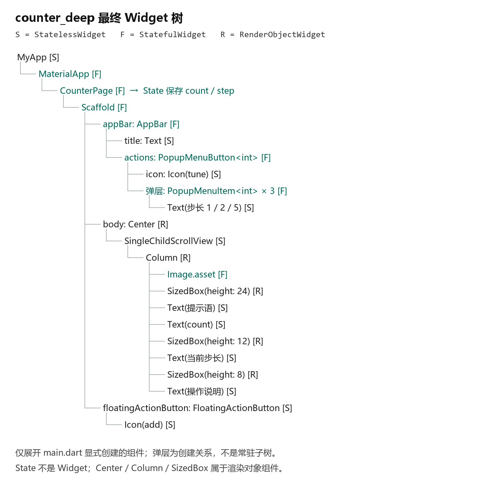
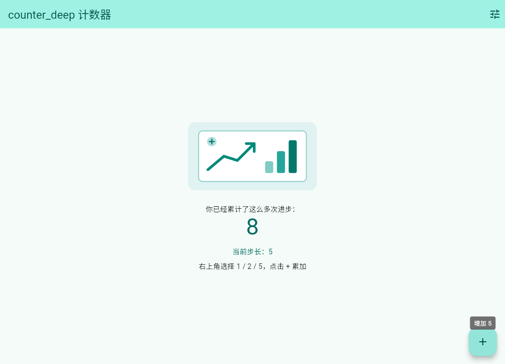
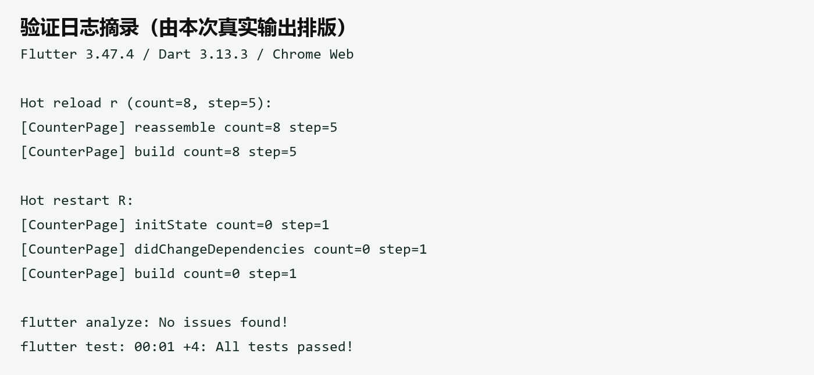
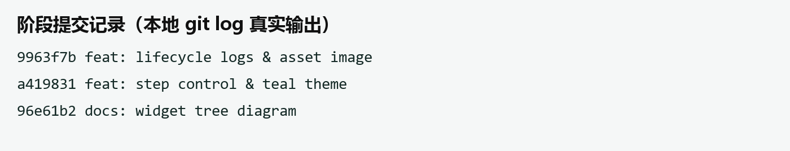

# 进度报告5

第7周 Flutter工程结构与Widget体系

## 任务理解：用自己的话说明本次作业要完成什么、验收标准是什么。

完成 guide-5 第五部分及6.1：创建 counter_deep，绘制 Widget 树，增加 1/2/5 步长、teal 主题、生命周期日志和本地图片。以功能结果、资源显示、r/R 日志、三次阶段提交及报告验收；口头讲解由本人完成。

## 环境与工具：本次使用的开发环境、运行目标（Web/模拟器/真机）与AI工具版本。

Windows 11；Flutter 3.47.4 stable，Dart 3.13.3。项目：F:/FlutterPractice/Day5/counter_deep。目标：Chrome Web 153.0.8010.53。AI：Codex（本会话），未使用 TraeWork。仅验证 Web；Android 许可证和 Windows C++ 工具链不完整。

## 过程记录：按时间线记录主要操作步骤（安装、创建、修改、运行）。

2026-10-21，读取指南，在 Day5 创建 counter_deep，保存官方 main.dart 供对照。

梳理 main → runApp → MyApp → MaterialApp → 页面 → Scaffold 启动链路，完成 Widget 树与组件类型说明。阶段提交：96e61b2。

将 _count 和 _step 放入 State；弹层选择 1/2/5，FAB 按步长累加；ThemeData 使用 teal，AppBar 和文字取用主题。阶段提交：a419831。

增加生命周期日志及原创矢量插画转出的 PNG，声明 assets/images/ 后完整启动。验证初始页面、弹层、累计值 8、热重载与热重启。阶段提交：9963f7b。

执行 flutter analyze 和 flutter test，修正日志捕获测试的恢复时机后，静态分析无问题，4 项测试通过；整理截图、真实日志及本报告。

## 关键代码：粘贴1至3段关键代码并逐行解释（注明是否AI生成、如何验证）。

代码一　状态与 setState（Codex 辅助编写；步长测试及浏览器交互验证）

```dart
int _count = 0;
int _step = 1;
void _increment() {
  setState(() {
    _count += _step;
  });
}
void _changeStep(int value) {
  setState(() { _step = value; });
}
```

第1—2行定义 State 中的累计值和步长；第3行是 FAB 回调；第4—6行同步修改数据并通知框架重建；第8—10行只修改步长，所以选择菜单不会清空累计值。实测按 1、2、5 累加得到 1、3、8。

```dart
theme: ThemeData(
  colorScheme: ColorScheme.fromSeed(
    seedColor: Colors.teal),
  useMaterial3: true,
),
// AppBar 取色
backgroundColor:
  Theme.of(context).colorScheme.primaryContainer,
// 当前步长文字取色
style: TextStyle(
  color: Theme.of(context).colorScheme.primary),
```

代码二　主题（Codex 辅助编写；主题组件测试验证）。第1—5行在应用层生成 Material 3 色彩方案；第7—8行让 AppBar 使用主题容器色；第10—11行让步长文字使用主题主色。主题统一配置，页面按语义取色。

```dart
@override
void initState() {
  super.initState();
  _log('initState');
}
Image.asset('assets/images/counter_banner.png',
  width: 260, height: 140),
```

代码三（Codex 辅助编写）：第1—5行先调用父类初始化再记日志；第6—7行为 build 中的图片读取片段。pubspec.yaml 的 flutter 下声明 assets/images/。生命周期测试、资源测试及实际截图验证通过。

## 检查点结果：计数器改造功能正确；能口头解释setState链路。附证据说明。

功能：默认 count=0、step=1；依次使用 1、2、5 点击 FAB，累计值为 1、3、8。切换步长不改变累计值；切回 1 再点一次为 9。组件测试和浏览器操作均验证了主要交互。

主题与资源：teal 色方案生效，AppBar、文字和 FAB 风格一致；本地 PNG 正常显示。360×640 逻辑像素下，图片与页面未触发布局异常。

图1为最终代码对应的 Widget 树。S/F/R 分别表示 StatelessWidget、StatefulWidget、RenderObjectWidget；原始计数器树另存 docs/widget_tree.md。



生命周期实测与 setState 解释

首次启动：initState → didChangeDependencies → build，count=0、step=1。点击 FAB 只触发相关重建，不重新初始化 State。

热重载 r：在 count=8、step=5 时输出 reassemble → build，保留 8 和 5，未再次输出 initState。热重启 R：重新输出 initState → didChangeDependencies → build，恢复 count=0、step=1。

配置及依赖：组件测试中，父组件更改标题触发 didUpdateWidget → build，count=1 保留；改变 Theme 触发 didChangeDependencies → build，主题动画期间可以重复执行。

销毁：测试移除页面后输出 deactivate → dispose。它们是普通组件卸载证据；不能将热重启视为保证调用 dispose 的过程。本例没有订阅或控制器，因而没有额外资源清理。

口头解释要点：点击 FAB 后调用 _increment，setState 同步执行回调修改 _count，并将对应 Element 标记为 dirty；框架调度后续帧执行 build，比较新旧配置，按需布局和绘制。界面由状态决定，不需要手工查找并修改 Text。

类型选择：MyApp 只提供配置，使用 StatelessWidget；CounterPage 需要保存交互状态，使用 StatefulWidget。Widget 本身不可变，可变数据位于独立的 State。口头讲解尚需本人练习确认。

## 问题与调试：遇到的问题、定位过程、解决方案（至少1条真实记录）。

真实问题一：生命周期测试暂时替换 debugPrint 来收集日志，最初用 addTearDown 恢复，测试报告“The value of a foundation debug variable was changed by the test”。定位到测试框架先检查全局变量、后执行 teardown；改为在测试体中用 try/finally 恢复，复测 4 项全部通过。初次失败与修复后日志均保留。

真实问题二：本机 flutter.bat 启动卡住，改为通过 SDK 自带 dart.exe 直接运行 flutter_tools.snapshot 后成功创建、测试及运行项目，未修改 SDK。Web 热重启还出现“Trying to render a disposed EngineFlutterView.”，随后提示重启成功且页面归零；此调试环境现象尚未修复，完整日志见 run_session.txt。

## AI使用记录：TraeCode使用清单（用途、指令摘要、输出、本人验证方式）。

实际使用：Codex 用于读取指南、创建工程、生成步长/主题/日志代码、绘制组件树和插画、执行验证及填报；本次未使用 TraeWork/TraeCode。请求摘要为“根据 guide-5 完成五和六的6.1并填写报告5”。代码与文档均应标注为 AI 辅助产出。

方案对照：初步的“固定 +=2”改为 State 保存 _step 并提供 1/2/5 弹层；“直接写颜色”改为 ThemeData 统一配置并 Theme.of 取色；“只放图片”补为声明资源并完整启动。初步方案和对照均由 Codex 提出，未冒充本人事前猜测。验证由 Codex 执行 analyze、4项组件测试和浏览器操作；本人仍需复核并独立讲解。

## 证据截图：运行截图、flutter doctor或控制台输出、Git提交记录（每图配一句话说明）。

图2为本次 Chrome 实际运行截图：累计值 8、当前步长 5，teal 主题和新增图片正常显示。其余原始截图与 flutter doctor 输出保存在 docs/evidence/。







## 自评：对照本次作业要求逐项自查完成情况。

案例复现、步长与主题、生命周期日志、本地资源、Widget 树、至少三次阶段提交及报告记录均已完成。静态分析通过，4项测试通过。远端仓库地址为 https://github.com/Su6731/FlutterStudy，当前改动已在本地提交，尚未推送。待本人完成代码复核、口头讲解及课堂提交；不将这些事项标为已验收。

## 一句话收获与下一步计划：本课一句话收获；遗留问题与下次课的预习要点

收获：理解了 UI=f(state)，修改 State 并通过 setState 通知框架，界面才随状态更新。下一步练习脱离代码讲清 FAB 的调用链，继续观察 Web 热重启断言，并预习布局约束、常见布局组件及路由基础。
